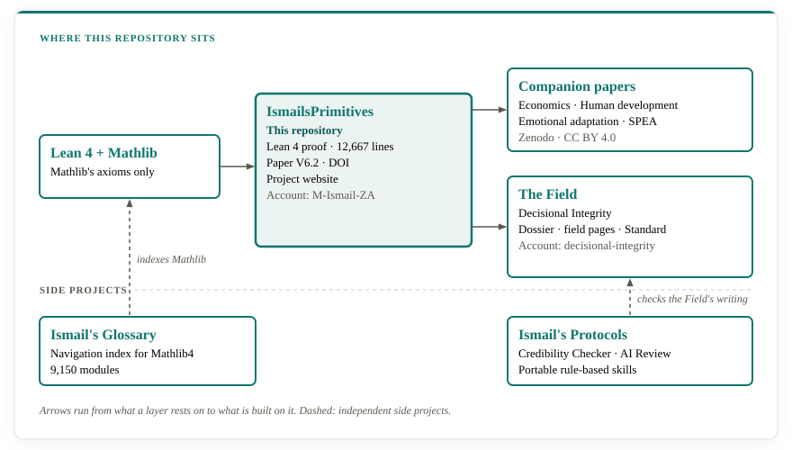
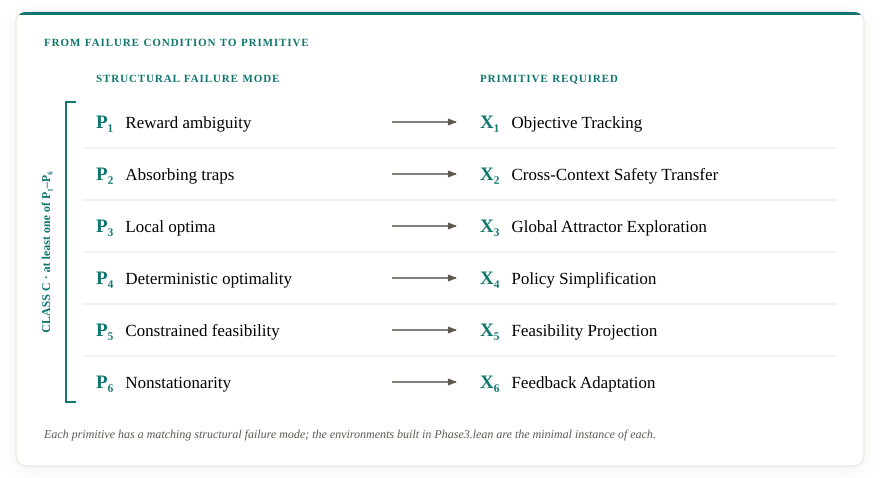
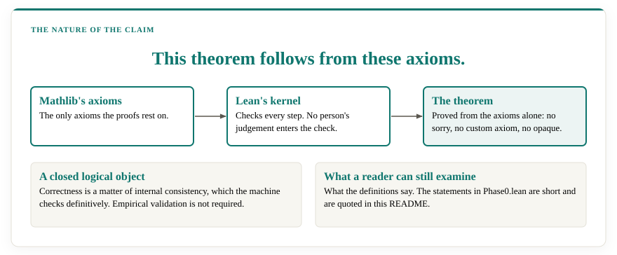
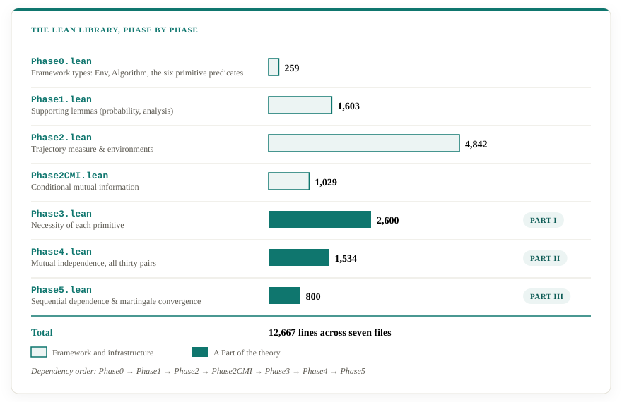
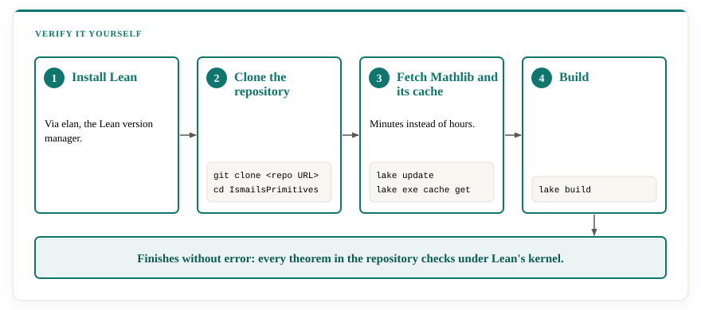
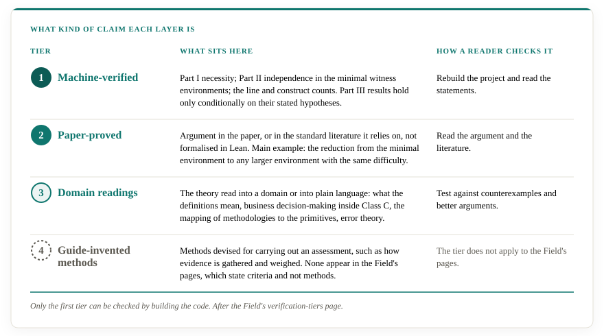
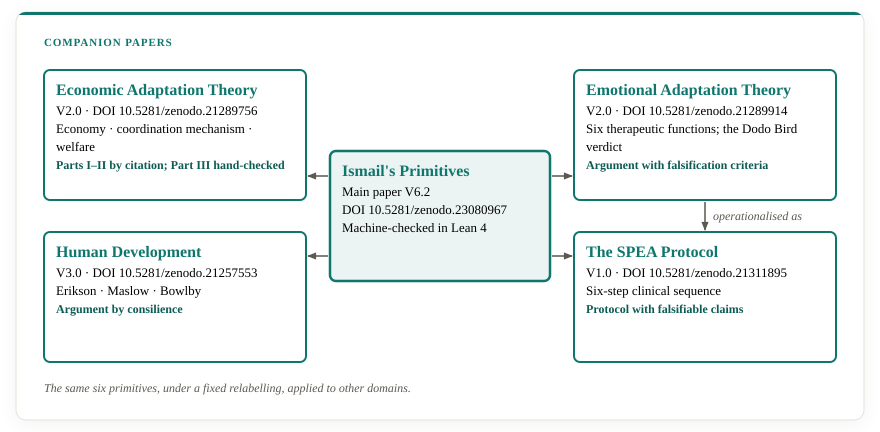

# Ismail's Primitives
*A Unified Functional Theory of Necessity, Independence, and Sequential Dependence in Adaptive Decision Systems*

[](https://github.com/M-Ismail-ZA/IsmailsPrimitives/actions/workflows/build.yml)
[](https://doi.org/10.5281/zenodo.23080967)


[](https://decisional-integrity.github.io/Field/)
[](https://orcid.org/0009-0000-3713-7105)

**[Website](https://m-ismail-za.github.io/IsmailsPrimitives/) · [Glossary](https://m-ismail-za.github.io/IsmailsGlossary/) · [Paper (DOI)](https://doi.org/10.5281/zenodo.23080967) · [The Field](https://decisional-integrity.github.io/Field/)**

**What must a decision-maker get right, structurally, to avoid failure under uncertainty?**

A complete Lean 4 / Mathlib formalization of **Ismail's Primitives**: a
functional theory of necessity, independence, and sequential dependence for
adaptive decision-making under uncertainty. This repository is the formal,
machine-checked companion to the paper of the same name — published on
Zenodo, DOI: [10.5281/zenodo.23080967](https://doi.org/10.5281/zenodo.23080967).
For the broader motivation, the POMDP framing, and worked examples across
investing, insurance, and consulting, see the
[companion website](https://m-ismail-za.github.io/IsmailsPrimitives/) — this
README stays close to the formalization itself.

The theory identifies six structural primitives that any decision-maker —
a person, an institution, or a machine — must possess to achieve sublinear
regret in a broad, yet precisely defined union class of partially observable environments under
uncertainty (the paper defines the specific environment class **Class C**), and
proves — entirely inside Lean's type theory, checked by the kernel, with
zero `sorry`, zero custom `axiom`, and zero `opaque` definitions — that
each primitive is:

- **Necessary**: its absence forces linear (Ω(T)) regret in an explicit,
  minimal environment built to exhibit that one structural failure (Part I,
  six independent theorems);
- **Mutually Independent**: no primitive is derivable from, or substitutable
  by, any other — verified across all thirty ordered pairs on a single
  compound environment (Part II, one master theorem covering every pair);
- **Sequentially Dependent**: the six primitives compose into a directed
  information chain X₁→X₂→⋯→X₆→X₁. Necessity is domain-invariant, so Parts I
  and II hold unconditionally; sufficiency is not — what "success" means is
  supplied by the domain, not by the theorem — so Part III proves exactly
  what generalizes: each link is established outright by a forward theorem,
  a reverse theorem, and a non-reversibility result, with the exact point
  where a domain's own goal enters the chain named explicitly rather than
  assumed away. The closing link is grounded in an explicit Doob martingale
  construction over cycles of play (Part III).

Every claim above traces to a specific, named identifier in this repository
— nothing is asserted without a corresponding, checkable Lean proof.

## Where this repository sits



This repository is the research core. The proof and the paper rest on Lean 4 and
Mathlib's axioms. The companion papers and the
[Field of Decisional Integrity](https://decisional-integrity.github.io/Field/) rest on the proof.
[Ismail's Glossary](#related-project-ismails-glossary) and
[Ismail's Protocols](#related-project-ismails-protocols) are independent side
projects.

The research lives under [M-Ismail-ZA](https://github.com/M-Ismail-ZA). The
Field is kept in a separate account,
[decisional-integrity](https://github.com/decisional-integrity), apart from the
proof it rests on.

## Contents

- [Where this repository sits](#where-this-repository-sits)
- [The Six Primitives](#the-six-primitives)
- [Failure conditions and Class C](#failure-conditions-and-class-c)
- [The three parts at a glance](#the-three-parts-at-a-glance)
- [The nature of the claim](#the-nature-of-the-claim)
- [Status](#status)
- [Structure](#structure)
- [Building it yourself](#building-it-yourself)
  - [Auditing the claims](#auditing-the-claims)
- [Using this as a dependency](#using-this-as-a-dependency)
- [From theorem to assessment](#from-theorem-to-assessment)
- [What is and isn't claimed](#what-is-and-isnt-claimed)
- [Common misunderstandings](#common-misunderstandings)
- [Papers](#papers)
- [Decisional Integrity: the Field](#decisional-integrity-the-field)
- [Related project: Ismail's Glossary](#related-project-ismails-glossary)
- [Related project: Ismail's Protocols](#related-project-ismails-protocols)
- [License](#license)
- [Author](#author)

## The Six Primitives

`SixPrimitives/Phase0.lean` defines six primitive predicates over decision
rules, referred to throughout the proof and the paper as X1–X6:

| | Primitive | What it requires |
| --- | --- | --- |
| **X1** | Objective Tracking | Maintain separate, updating beliefs about which of several live hypotheses is true, rather than collapsing to one prematurely. |
| **X2** | Cross-Context Safety Transfer | Identify actions that lead to an unrecoverable state and exclude them from the policy. |
| **X3** | Global Attractor Exploration | Keep exploring past a locally comfortable but globally suboptimal plateau. |
| **X4** | Policy Simplification | Convert settled evidence into a fixed, committed decision rather than continuing to hedge. |
| **X5** | Feasibility Projection | Enforce a hard constraint as non-negotiable rather than trading it off against reward. |
| **X6** | Feedback Adaptation | Revise a belief or policy once the environment generating the evidence has shifted. |

Each primitive has a matching structural failure mode (P1–P6 in the paper:
reward ambiguity, absorbing traps, local optima, deterministic optimality,
constrained feasibility, and nonstationarity) — the environments built in
`Phase3.lean` are the minimal instance of each.

## Failure conditions and Class C



An environment that exhibits at least one of P₁–P₆ is in **Class C**. In
`Phase0.lean` it is the disjunction of six existential statements, one per
property ([Phase0.lean:218](https://github.com/M-Ismail-ZA/IsmailsPrimitives/blob/784bb84/SixPrimitives/Phase0.lean#L218)):

```lean
def InClassC (env : Env S A O)
    (visitFreq : Env S A O → S → ℝ → Prop) : Prop :=
  (∃ env' : Env S A O, HasP₁ env env') ∨
  (∃ S_abs : Set S, HasP₂ env S_abs) ∨
  (∃ S_local S_global : Set S, HasP₃ env S_local S_global) ∨
  (∃ (s_star : S) (a_star : A), HasP₄ env s_star a_star visitFreq) ∨
  (∃ (F : Set A) (M : ℝ), HasP₅ env F M) ∨
  (∃ (envs : ℕ → Env S A O) (tau : ℕ), envs 0 = env ∧ HasP₆ envs tau)
```

Lacking a primitive is stated as a persistent, quantified failure of the
quantity that primitive controls. For example, lacking X₁ means the mutual
information the algorithm gathers stays bounded below ½
([Phase0.lean:69](https://github.com/M-Ismail-ZA/IsmailsPrimitives/blob/784bb84/SixPrimitives/Phase0.lean#L69)):

```lean
def LacksX₁ (mi : ℕ → ℝ) : Prop :=
  ∃ B : ℝ, B < 1/2 ∧ limsup (fun t : ℕ => mi t) atTop ≤ B
```

The six lacking-conditions, each defined in `Phase0.lean`:

| Primitive | Lacking it means | Definition |
| --- | --- | --- |
| X₁ | the limsup of the mutual-information sequence is at most some B < ½ | [`LacksX₁`](https://github.com/M-Ismail-ZA/IsmailsPrimitives/blob/784bb84/SixPrimitives/Phase0.lean#L69) |
| X₂ | the danger probability stays at or above some δ > 0 at every step | [`LacksX₂`](https://github.com/M-Ismail-ZA/IsmailsPrimitives/blob/784bb84/SixPrimitives/Phase0.lean#L74) |
| X₃ | the cumulative count of bridge actions is bounded by a constant C | [`LacksX₃`](https://github.com/M-Ismail-ZA/IsmailsPrimitives/blob/784bb84/SixPrimitives/Phase0.lean#L80) |
| X₄ | the liminf of the conditional entropy is at least some ε > 0 | [`LacksX₄`](https://github.com/M-Ismail-ZA/IsmailsPrimitives/blob/784bb84/SixPrimitives/Phase0.lean#L85) |
| X₅ | the Cesàro average of the infeasible-play probability has liminf at least δ > 0 | [`LacksX₅`](https://github.com/M-Ismail-ZA/IsmailsPrimitives/blob/784bb84/SixPrimitives/Phase0.lean#L94) |
| X₆ | the stale arm keeps probability at least ½ + δ throughout a window after the change point τ | [`LacksX₆`](https://github.com/M-Ismail-ZA/IsmailsPrimitives/blob/784bb84/SixPrimitives/Phase0.lean#L99) |

The lower bounds are proved on the minimal environment that exhibits each
property. Passing from the minimal environment to any larger environment with
the same difficulty is the standard lower-bound argument. It is carried in the
paper and is not formalised in Lean; [What is and isn't
claimed](#what-is-and-isnt-claimed) keeps that distinction visible.

Class C is defined here as stated. Which real decision structures fall inside
it is a question of application, and the Field's
[Class C page](https://decisional-integrity.github.io/Field/field/class-c/) takes it up. The
[misunderstandings document](common-misunderstandings.md#misunderstanding-7-missing-the-epistemological-core)
gives the short argument that a business, distilled to its states, actions,
observations and rewards, is a POMDP.

## The three parts at a glance


Line numbers below are pinned to commit
[`784bb84`](https://github.com/M-Ismail-ZA/IsmailsPrimitives/tree/784bb84) (2026-10-29), so each
link resolves to the same line after the files change.

**Part I, necessity.** One theorem per primitive, each in `Phase3.lean`.

| Primitive | Theorem | Location |
| --- | --- | --- |
| X₁ | `SixPrimitives.necessity_x1` | [Phase3.lean:122](https://github.com/M-Ismail-ZA/IsmailsPrimitives/blob/784bb84/SixPrimitives/Phase3.lean#L122) |
| X₂ | `SixPrimitives.necessity_x2` | [Phase3.lean:931](https://github.com/M-Ismail-ZA/IsmailsPrimitives/blob/784bb84/SixPrimitives/Phase3.lean#L931) |
| X₃ | `SixPrimitives.necessity_x3` | [Phase3.lean:1556](https://github.com/M-Ismail-ZA/IsmailsPrimitives/blob/784bb84/SixPrimitives/Phase3.lean#L1556) |
| X₄ | `SixPrimitives.necessity_x4` | [Phase3.lean:1831](https://github.com/M-Ismail-ZA/IsmailsPrimitives/blob/784bb84/SixPrimitives/Phase3.lean#L1831) |
| X₅ | `SixPrimitives.necessity_x5` | [Phase3.lean:2046](https://github.com/M-Ismail-ZA/IsmailsPrimitives/blob/784bb84/SixPrimitives/Phase3.lean#L2046) |
| X₆ | `SixPrimitives.necessity_x6` | [Phase3.lean:2575](https://github.com/M-Ismail-ZA/IsmailsPrimitives/blob/784bb84/SixPrimitives/Phase3.lean#L2575) |

**Part II, mutual independence.** One master theorem covers all thirty ordered
pairs: `SixPrimitives.Phase4.mutual_independence`, at [Phase4.lean:1480](https://github.com/M-Ismail-ZA/IsmailsPrimitives/blob/784bb84/SixPrimitives/Phase4.lean#L1480).

**Part III, sequential dependence.** Six links, each with a forward theorem, a
reverse theorem and a non-reversibility result, all in `Phase5.lean` under
`SixPrimitives.Phase5`. The last link closes the chain through Doob's
convergence theorem.

| Link | Method named in the file | Forward | Reverse | Non-reversible |
| --- | --- | --- | --- | --- |
| X₁ → X₂ | information-theoretic, data-processing inequality | [`iet1_forward`](https://github.com/M-Ismail-ZA/IsmailsPrimitives/blob/784bb84/SixPrimitives/Phase5.lean#L222) | [`iet1_reverse`](https://github.com/M-Ismail-ZA/IsmailsPrimitives/blob/784bb84/SixPrimitives/Phase5.lean#L231) | [`iet1_non_reversible`](https://github.com/M-Ismail-ZA/IsmailsPrimitives/blob/784bb84/SixPrimitives/Phase5.lean#L239) |
| X₂ → X₃ | information-theoretic, survival | [`iet2_forward`](https://github.com/M-Ismail-ZA/IsmailsPrimitives/blob/784bb84/SixPrimitives/Phase5.lean#L278) | [`iet2_reverse`](https://github.com/M-Ismail-ZA/IsmailsPrimitives/blob/784bb84/SixPrimitives/Phase5.lean#L310) | [`iet2_non_reversible`](https://github.com/M-Ismail-ZA/IsmailsPrimitives/blob/784bb84/SixPrimitives/Phase5.lean#L362) |
| X₃ → X₄ | information-theoretic, dominated convergence | [`iet3_forward`](https://github.com/M-Ismail-ZA/IsmailsPrimitives/blob/784bb84/SixPrimitives/Phase5.lean#L404) | [`iet3_reverse`](https://github.com/M-Ismail-ZA/IsmailsPrimitives/blob/784bb84/SixPrimitives/Phase5.lean#L439) | [`iet3_non_reversible`](https://github.com/M-Ismail-ZA/IsmailsPrimitives/blob/784bb84/SixPrimitives/Phase5.lean#L489) |
| X₄ → X₅ | behavioral prerequisite | [`iet4_forward`](https://github.com/M-Ismail-ZA/IsmailsPrimitives/blob/784bb84/SixPrimitives/Phase5.lean#L553) | [`iet4_reverse`](https://github.com/M-Ismail-ZA/IsmailsPrimitives/blob/784bb84/SixPrimitives/Phase5.lean#L573) | [`iet4_non_reversible`](https://github.com/M-Ismail-ZA/IsmailsPrimitives/blob/784bb84/SixPrimitives/Phase5.lean#L592) |
| X₅ → X₆ | information-theoretic, log-likelihood-ratio drift | [`iet5_forward`](https://github.com/M-Ismail-ZA/IsmailsPrimitives/blob/784bb84/SixPrimitives/Phase5.lean#L624) | [`iet5_reverse`](https://github.com/M-Ismail-ZA/IsmailsPrimitives/blob/784bb84/SixPrimitives/Phase5.lean#L644) | [`iet5_non_reversible`](https://github.com/M-Ismail-ZA/IsmailsPrimitives/blob/784bb84/SixPrimitives/Phase5.lean#L663) |
| X₆ → X₁ | accumulative closure, Doob's convergence | [`iet6_forward`](https://github.com/M-Ismail-ZA/IsmailsPrimitives/blob/784bb84/SixPrimitives/Phase5.lean#L695) | [`iet6_reverse`](https://github.com/M-Ismail-ZA/IsmailsPrimitives/blob/784bb84/SixPrimitives/Phase5.lean#L776) | [`iet6_non_reversible`](https://github.com/M-Ismail-ZA/IsmailsPrimitives/blob/784bb84/SixPrimitives/Phase5.lean#L786) |

The closing link also has [`iet6_accumulative`](https://github.com/M-Ismail-ZA/IsmailsPrimitives/blob/784bb84/SixPrimitives/Phase5.lean#L739) and
[`iet6_accumulative_convergence`](https://github.com/M-Ismail-ZA/IsmailsPrimitives/blob/784bb84/SixPrimitives/Phase5.lean#L758). Part III results are
conditional theorems. Each holds under hypotheses that its statement names. The
header of `Phase5.lean` says what it abstracts: the proof that the primitives
generate the required convergence conditions is left as an explicit
prerequisite for the implementer.

## The nature of the claim



Every result in this repository is a deductive claim: *this theorem follows from
these axioms.* The proof is a closed logical object. Whether it is correct is a
question of internal consistency, and Lean's kernel decides that definitively,
so no empirical validation is needed for the theorems to hold. What a reader
can examine for themselves is what the definitions say. The statements in
`Phase0.lean` are short and are quoted above.

Part III results are conditional theorems, and they are closed logical objects
in the same way: each follows from its stated hypotheses and those axioms.

## Status


|                     |                                |
| ------------------- | ------------------------------ |
| Lines of Lean       | 12,667                         |
| `sorry`             | 0                              |
| `axiom`             | 0                              |
| `opaque`            | 0                              |
| Linter suppressions | 0                              |
| Lean toolchain      | `leanprover/lean4:v4.30.0` |
| Mathlib             | verified against `v4.30.0`     |

Every definition and theorem in this repository is proved from Mathlib's
axioms alone — no `sorry`, no custom `axiom`, no `opaque` escape hatches, and
no disabled linters. The build log in the Actions tab above is the evidence:
if it's green, the whole library compiles and every proof checks. You don't
have to take the table's word for it — the "Building it yourself" section
below reproduces the same check on your own machine.

The line count is the seven files under `SixPrimitives/` and is current as of
2026-10-29 (commit `784bb84`). The root import file `SixPrimitives.lean` adds seven
more lines.

## Structure



The library is organized into phases, each building on the last:

| File | Lines | Contents |
| --- | ---: | --- |
| `SixPrimitives.lean` | — | Root import |
| `SixPrimitives/Phase0.lean` | 259 | Framework types: `Env`, `Algorithm`, the six primitive predicates |
| `SixPrimitives/Phase1.lean` | 1,603 | Supporting lemmas (probability, analysis) |
| `SixPrimitives/Phase2.lean` | 4,842 | Trajectory measure & environments |
| `SixPrimitives/Phase2CMI.lean` | 1,029 | Conditional mutual information |
| `SixPrimitives/Phase3.lean` | 2,600 | **Part I** — necessity of each primitive |
| `SixPrimitives/Phase4.lean` | 1,534 | **Part II** — mutual independence, all thirty pairs |
| `SixPrimitives/Phase5.lean` | 800 | **Part III** — sequential dependence & martingale convergence |

Dependency order: `Phase0 → Phase1 → Phase2 → Phase2CMI → Phase3 → Phase4 → Phase5`.
Each file only imports the phases before it, so you can read them in that
order and every definition you meet has already been introduced.

## Building it yourself

You don't need to trust the badge — you can verify the whole thing on your
own machine in a few minutes.



**1. Install Lean** (via `elan`, the Lean version manager), if you don't have
it already: see <https://leanprover-community.github.io/get_started.html>.

**2. Clone the repository:**

```
git clone https://github.com/M-Ismail-ZA/IsmailsPrimitives.git
cd IsmailsPrimitives
```

**3. Fetch the Mathlib dependency and its precompiled build cache** (this is
what makes the build take minutes instead of hours — it downloads prebuilt
Mathlib binaries instead of compiling Mathlib from source):

```
lake update
lake exe cache get
```

**4. Build:**

```
lake build
```

If it finishes without error, you have independently confirmed that every
theorem in this repository checks under Lean's kernel.

You can also open the folder in VS Code with the `lean4` extension installed
and browse/step through any file interactively.

### Auditing the claims

The Status table can be checked without a full build. The commands below were
run on a fresh clone at commit [`784bb84`](https://github.com/M-Ismail-ZA/IsmailsPrimitives/tree/784bb84)
on 2026-10-29. The first two printed nothing and the third printed one line.

```
# 1. No sorry, custom axiom or opaque definition (no output means none found)
grep -rnE "\bsorry\b|^\s*axiom\b|\bopaque\b" SixPrimitives SixPrimitives.lean

# 2. No native_decide, unsafe code or linter suppression (no output means none found)
grep -rnE "native_decide|unsafe|implemented_by|@\[extern|ofReduceBool|admit\b|nolint|set_option linter" SixPrimitives SixPrimitives.lean

# 3. Every set_option in the library
grep -rn "set_option" SixPrimitives SixPrimitives.lean
```

The third command prints one line:

```
SixPrimitives/Phase2.lean:23:set_option synthInstance.maxHeartbeats 500000
```

That option raises the limit on instance search. It switches off no check.

A text search is only a first pass. The build is the authority. After
`lake build`, you can ask Lean what any single theorem depends on. Put this in a
scratch file and run it with `lake env lean scratch.lean`:

```lean
import SixPrimitives
#print axioms SixPrimitives.necessity_x1
```

A result that rests only on Lean's three standard axioms lists `propext`,
`Classical.choice` and `Quot.sound`. A `sorryAx`, or any axiom not named there,
would mark a gap.

## Using this as a dependency

If you want to build on top of Ismail's Primitives in your own Lean project,
add this to your `lakefile.lean`:

```
require SixPrimitives from git
  "https://github.com/M-Ismail-ZA/IsmailsPrimitives.git"
```

and `import SixPrimitives` (or a specific phase, e.g. `import SixPrimitives.Phase0`).

## From theorem to assessment


The theorems say what a decision-maker must get right to avoid guaranteed
failure. The [Field](https://decisional-integrity.github.io/Field/) turns that into an assessment with four steps.
The [misunderstandings document](common-misunderstandings.md) sets out the full
pipeline.

1. **Distill the proposal to a POMDP**: states, actions, observations,
   transitions, rewards and the initial distribution.
2. **Identify which Class C properties are present**: P₁ to P₆. Any one puts the
   environment in Class C.
3. **Assess the primitives**: for each property present, does the
   decision-maker possess the matching primitive?
4. **Declare the outcome**: if every required primitive is possessed, the
   proposal avoids guaranteed linear regret, though it may still fail for other
   reasons. If any is lacking, the theorems give linear regret.

The Field words its own verdicts more narrowly: a verdict "makes no forecast of
success or failure." It states whether a structure possesses the primitives its
environment requires, which is the structural question the theorems answer.

### Tracing a claim to the axioms


Any finding made with the Field's Standard can be followed down to the axioms in
five steps: the finding, the Field criterion it relies on, the numbered paper
result, the Lean theorem (file and line), and Mathlib's axioms. The row
beneath them shows who checks what: Lean verifies Ismail, Ismail verifies the
application, and the client verifies that the two agree.

## What is and isn't claimed



Necessity is a floor, and it holds in every domain. Sufficiency is a ceiling,
and each domain defines it. The theorems prove what must be present to avoid
guaranteed failure. They do not say how to succeed, because what success means
is supplied by the domain.

The Field sorts every statement by how it can be checked
([verification tiers](https://decisional-integrity.github.io/Field/field/verification-tiers/)). Using its names:

| Tier | What sits here | How a reader checks it |
| --- | --- | --- |
| Machine-verified | Part I necessity; Part II independence in the minimal witness environments; the line and construct counts. Part III results hold only conditionally on their stated hypotheses. | Rebuild the project and read the statements. |
| Paper-proved | Argument in the paper, or in the standard literature it relies on, not formalised in Lean. Main example: the reduction from the minimal environment to any larger environment with the same difficulty. | Read the argument and the literature. |
| Domain readings | The theory read into a domain or into plain language: what the definitions mean, business decision-making inside Class C, the mapping of methodologies to the primitives, error theory. | Test against counterexamples and better arguments. |
| Guide-invented methods | Methods devised for carrying out an assessment, such as how evidence is gathered and weighed. None appear in the Field's pages, which state criteria and not methods. | The tier does not apply to the Field's pages. |

## Common misunderstandings

The theory draws recurring objections. The
[misunderstandings document](common-misunderstandings.md) answers each in full.
Five of them, in brief:

| Objection | In brief | Full answer |
| --- | --- | --- |
| The theory rests on standard mathematics, so it is derivative or weak. | The mathematics is standard by design. The contribution is proving that the same bounds apply to human institutions as well as algorithms. | [Misunderstanding 1](common-misunderstandings.md#misunderstanding-1-mistaking-standard-mathematics-for-weakness) |
| The definitions are vacuous or trivial. | Negation is the correct form for impossibility theorems, the thresholds are derived from minimal environments, Class C is a taxonomy, and independence answers substitutability. | [Misunderstanding 2](common-misunderstandings.md#misunderstanding-2-calling-the-definitions-vacuous-or-trivial) |
| It proves necessity but not sufficiency. | That is the scope. Success is domain-dependent and interpretive. Failure is structural and mathematical. | [Misunderstanding 3](common-misunderstandings.md#misunderstanding-3-conflating-necessity-with-sufficiency) |
| The cross-domain papers are speculation. | They are hypotheses built on a verified foundation. Where the transfer is interpretive it carries no machine check. | [Misunderstanding 4](common-misunderstandings.md#misunderstanding-4-dismissing-cross-domain-transfers-as-speculation) |
| Applying the mathematics to business is a stretch. | A business decision, distilled to its components, is a POMDP and behaves as an algorithm does under the same bounds. | [Misunderstanding 7](common-misunderstandings.md#misunderstanding-7-missing-the-epistemological-core) |

## Papers

This formalization is standalone: it does not depend on any paper, and
every result here is fully self-contained and machine-checked. The main
paper draws every one of its formal claims from this repository and
cross-references each theorem, definition, and environment to its exact
Lean identifier and line range (see the correspondence tables in the
paper's appendix) — so any claim in the paper can be checked against the
source it names, not taken on faith.

### Main paper

**Ismail's Primitives: A Unified Functional Theory of Necessity,
Independence, and Sequential Dependence in Adaptive Decision Systems**
Muhammed Ismail, Zenodo, V6.2 (2026).
DOI: [10.5281/zenodo.23080967](https://doi.org/10.5281/zenodo.23080967) · CC BY 4.0

```bibtex
@article{ismail2026primitives,
  author    = {Ismail, Muhammed},
  title     = {Ismail's Primitives: A Unified Functional Theory of Necessity,
               Independence, and Sequential Dependence in Adaptive Decision
               Systems},
  year      = {2026},
  publisher = {Zenodo},
  version   = {V6.2},
  doi       = {10.5281/zenodo.23080967},
  url       = {https://doi.org/10.5281/zenodo.23080967}
}
```

📄 Also in this repository: [full PDF](paper/Ismails_Primitives.pdf) · [Markdown edition](paper/PAPER.md)

### Extending Ismail's Primitives

The necessity results are stated abstractly enough to travel beyond
business decision-making. Companion papers apply the same six primitives,
under a fixed relabelling, to other domains — each cites the exact Lean
declaration and line range it draws on, the same way the main paper does:



- **Ismail's Primitives and Human Development: A Functional Isomorphism
  Between a Lean-Verified Computational Theory and Developmental
  Psychology.** Argues that Erikson's psychosocial stages, Maslow's
  motivational hierarchy, and Bowlby's attachment phases independently
  converge on the same six-stage sequence proven necessary here.
  DOI: [10.5281/zenodo.21257553](https://doi.org/10.5281/zenodo.21257553) (V3.0)

- **Ismail's Primitives: An Emotional Adaptation Theory
  Discovered through Functional Isomorphism.** Derives six therapeutic
  functions from the same primitives, giving the "Dodo Bird verdict" — the
  finding that no single therapy modality reliably outperforms the others —
  a structural explanation.
  DOI: [10.5281/zenodo.21289914](https://doi.org/10.5281/zenodo.21289914) (V2.0)

- **Ismail's Primitives: Lean-verified Economic Adaptation Theory.**
  Re-derives the same necessity and independence theorems under a
  relabelling to economy / coordination mechanism / welfare, recovering
  Walrasian equilibrium as the special case that falls outside Class C.
  DOI: [10.5281/zenodo.21289756](https://doi.org/10.5281/zenodo.21289756) (V2.0)

- **Ismail's Primitives: The SPEA Protocol for Clinical Psychology.**
  SPEA (Six Primitives of Emotional Adaptation) is a six-step clinical
  sequence: Emotional Archaeology, Pattern Mapping, Emotional Imagination,
  Authentic Distillation, Embodied Integration, and Narrative Weaving. The
  protocol carries a research programme built on five falsification criteria,
  each paired with a study design capable of overturning it.
  DOI: [10.5281/zenodo.21311895](https://doi.org/10.5281/zenodo.21311895) (V1.0)

Further papers extending the theory are in preparation. All papers above
are CC BY 4.0; the Lean formalization in this repository is MIT.

## Decisional Integrity: the Field

Decisional Integrity is the property a structure has when, in a Class C
environment, it possesses all six primitives. The Field is the documentation for
that idea: the question, the definition, the argument, the standard for assessing
it, and the evidence that motivates it. Every theorem it uses rests on this
repository.

- Decisional Integrity: [github.com/decisional-integrity/Field](https://github.com/decisional-integrity/Field)
- Site: [decisional-integrity.github.io/Field](https://decisional-integrity.github.io/Field/)
- The Standard, with criteria for each primitive: [Standard](https://decisional-integrity.github.io/Field/standard/standard/)
- Class C and applicability: [Class C](https://decisional-integrity.github.io/Field/field/class-c/)
- Support for each kind of claim: [verification tiers](https://decisional-integrity.github.io/Field/field/verification-tiers/)
- Where assessments can go wrong: [error theory](https://decisional-integrity.github.io/Field/field/error-theory/)
- An empirical synthesis of 26 articles on eight consulting and audit firms,
  assessed separately from the theory: [the Dossier](https://decisional-integrity.github.io/Field/dossier/)

The Standard is applied as a commercial service by
[Literacity](https://literacity.github.io/decisional-assurance), which is kept
separate from the research and from the Field.

## Related project: Ismail's Glossary


Formalizing this proof meant learning Mathlib well enough to navigate its
9,150 modules — and that work produced a second, independent project as a
byproduct: **Ismail's Glossary**, a complete navigation index for Mathlib4.
It gives every module a short, human-readable description, an interactive
atlas of how Mathlib's 32 top-level domains relate, and a progressive
reference for learning Lean itself.

- Website: [m-ismail-za.github.io/IsmailsGlossary](https://m-ismail-za.github.io/IsmailsGlossary/)
- Repository: [github.com/M-Ismail-ZA/IsmailsGlossary](https://github.com/M-Ismail-ZA/IsmailsGlossary)
- Paper: *Ismail's Glossary: A Complete Navigation Index for Mathlib4*,
  Zenodo, V1.0 (2026).
  DOI: [10.5281/zenodo.21192789](https://doi.org/10.5281/zenodo.21192789)

## Related project: Ismail's Protocols

A second side project, independent of the theory. **Ismail's Protocols** packages two rule-based evaluation protocols as
portable AI skills, with porting guides for Claude, ChatGPT and Gemini: a
Credibility Checker with eight rules for judging whether a claim is well
supported, and an AI Review with 21 rules for spotting the fingerprints of
AI-generated writing. The Field uses both to check its own pages.

- Repository: [github.com/M-Ismail-ZA/IsmailsProtocols](https://github.com/M-Ismail-ZA/IsmailsProtocols)
- Citation: GitHub only, no DOI. The repository's README gives a suggested
  citation and BibTeX entry.
- License: split by kind. Rule content is CC BY 4.0. Instructional prose and
  tooling are MIT. The AI Review rule catalog is adapted from Wikipedia's *Signs
  of AI writing* and carries an additional share-alike obligation; see the
  repository's `LICENSE-CONTENT` for the terms.

## License

- **Lean formalization** (this repository): released under the
  [MIT License](https://github.com/M-Ismail-ZA/IsmailsPrimitives/blob/main/LICENSE).
- **Papers**: released under CC BY 4.0 — free to use, cite, and build on;
  attribution is the only requirement.

## Author

Muhammed Ismail is a theoretical mathematician based in South Africa,
working on formal verification and decision theory under uncertainty, with
companion work in economics and psychology. The six primitives were first
noticed as a recurring pattern in his own decision-making in September
2025, and developed into a complete theory over the months that followed.

The proof was built in Lean 4 — every claim checked by the kernel
deterministically. Ismail then learned Mathlib well enough to produce this
repository's 12,667 lines, and, as a byproduct of the learning itself,
[Ismail's Glossary](#related-project-ismails-glossary).

Email: <literacity@outlook.com> · ORCID: [0009-0000-3713-7105](https://orcid.org/0009-0000-3713-7105) · [LinkedIn](https://www.linkedin.com/in/researcher-adaptationtheory/)
